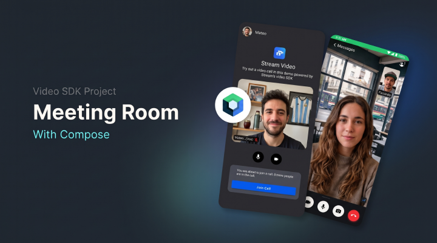
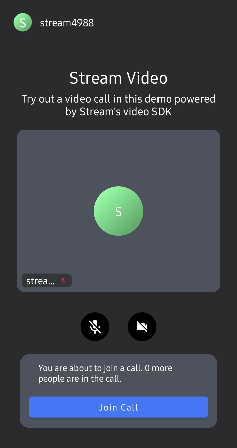
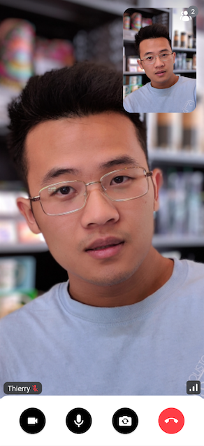
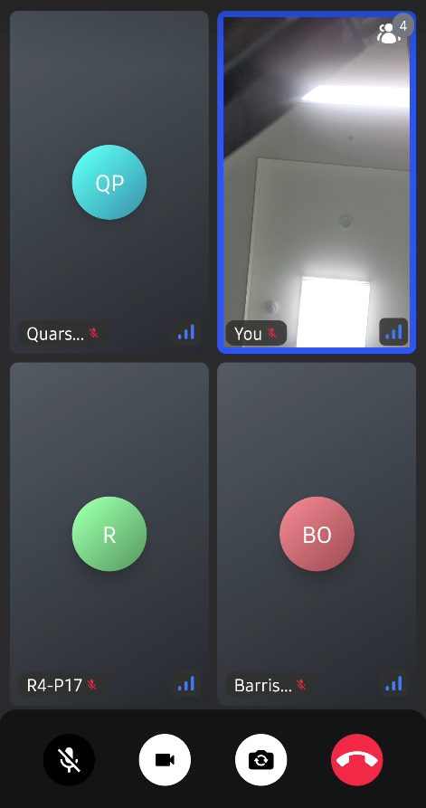
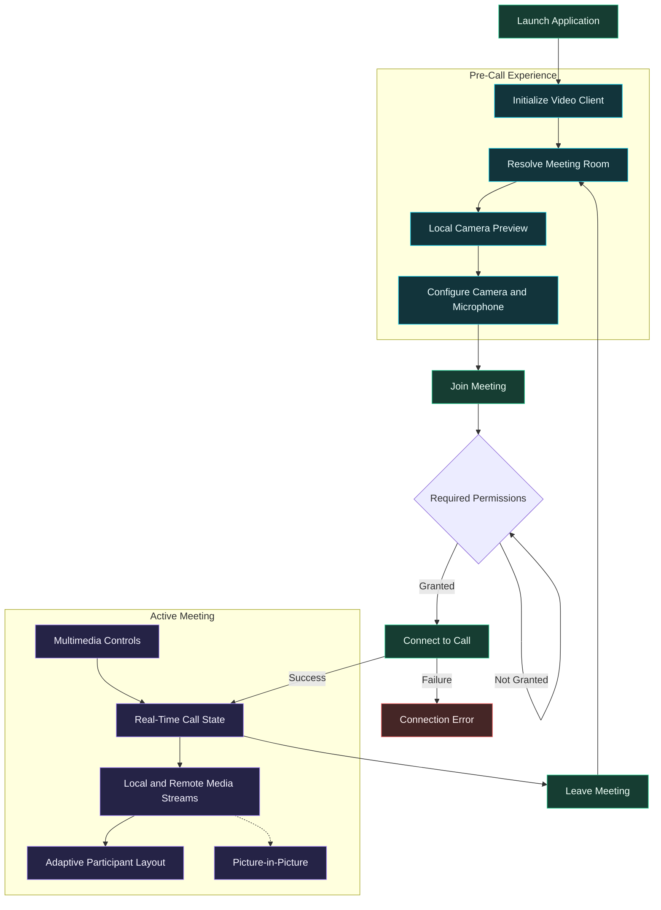

<div align="center">

  

  <h1>Meeting Room</h1>

  <p>
    <strong>Making distance feel a little smaller.</strong>
  </p>

  <p>
    A native Android video conferencing application exploring
    real-time communication, interactive meeting experiences,
    and multimedia integration with Kotlin and Jetpack Compose.
  </p>

  <p>
    Android · Kotlin · Jetpack Compose · WebRTC
  </p>

  <p>
    <a href="#about">About</a> ·
    <a href="#app-preview">Preview</a> ·
    <a href="#features">Features</a> ·
    <a href="#under-the-hood">Under the Hood</a> ·
    <a href="#getting-started">Getting Started</a>
  </p>

  

  <br />

  <sub>
    Early Works · Native Android Development · Real-Time Communication
  </sub>

</div>

## About

Meeting Room is a native Android application centered around
a simple experience: connecting people through real-time
video and audio communication.

The application combines a pre-call lobby, interactive video
layouts, participant management, and essential multimedia
controls within a declarative interface built with
Jetpack Compose.

From preparing the camera and microphone before joining
a meeting to interacting with multiple participants,
the interface focuses on making communication accessible
and straightforward.

Part of my early explorations in Android development,
this project represents an opportunity to experiment with
real-time systems, multimedia integration, asynchronous
state management, and the challenges of building
connected mobile experiences.

## App Preview

<div align="center">

  
  
  

  <p>
    <sub>
      Meeting lobby · Video calling · Multi-participant conferencing
    </sub>
  </p>

</div>

### Before the Meeting

The pre-call lobby provides a dedicated space to prepare
the device before entering a meeting.

Users can preview their camera, configure microphone
and camera availability, inspect participant presence,
and join the configured meeting room.

### During the Meeting

The active meeting interface prioritizes communication
through an adaptive participant layout and a compact
set of multimedia controls.

Video streams, participant avatars, microphone indicators,
and connection information provide visual context
throughout the conversation.

The layout adapts to different participant configurations,
from individual conversations to group meetings.

## Features

| Feature | Description |
| :--- | :--- |
| **Real-Time Video Calling** | Interactive video communication between connected participants. |
| **Audio Communication** | Real-time microphone input and audio playback. |
| **Meeting Lobby** | Prepare multimedia devices before joining a call. |
| **Camera Preview** | Preview the local video feed before entering a meeting. |
| **Group Meetings** | Display multiple participants within a shared video conference. |
| **Adaptive Video Layout** | Organize participant video streams according to the meeting configuration. |
| **Microphone Control** | Enable or disable microphone input during a meeting. |
| **Camera Control** | Enable or disable the local video stream. |
| **Camera Switching** | Switch between available device cameras. |
| **Participant Indicators** | Display participant identities, avatars, and media status. |
| **Speaking While Muted** | Notify users when speech is detected while the microphone is muted. |
| **Picture-in-Picture** | Support continued video visualization through the SDK's PiP integration. |
| **Runtime Permissions** | Request the required Android multimedia permissions. |
| **Reactive UI** | Synchronize the interface with changing call and device states. |

## Meeting Experience

The application follows a straightforward meeting lifecycle,
from initial client configuration to active communication
and call termination.



The application manages the native Android interface,
navigation, device interaction, and observable UI state.

The underlying video SDK handles real-time media transport,
call connectivity, and participant synchronization.

## Under the Hood

Meeting Room explores the relationship between declarative
Android interfaces and asynchronous communication systems.

The application uses ViewModels to coordinate screen
state and meeting operations, while Jetpack Compose
reacts to changes in camera availability, microphone
status, connection results, and participant information.

### Application Architecture

| Component | Responsibility |
| :--- | :--- |
| `MeetingRoomApp` | Application initialization and meeting configuration. |
| `MainActivity` | Native Android activity and application entry point. |
| `MeetingRoomNavHost` | Navigation between the lobby and active meeting. |
| `MainViewModel` | Video client initialization and pre-call state management. |
| `LobbyScreen` | Meeting preparation and local multimedia controls. |
| `CallViewModel` | Meeting connection, call termination, and connection state. |
| `CallScreen` | Active meeting interface and participant rendering. |
| `MeetingRoomTheme` | Application appearance and video component styling. |

### Reactive State Management

The application uses Kotlin Flow and StateFlow to
represent observable changes throughout the meeting
lifecycle.

The lobby and active meeting maintain independent
UI state models, allowing the interface to respond
to loading, connection, and error conditions.

Lifecycle-aware state collection connects these
models to the corresponding Compose screens.

### Real-Time Communication

Real-time video and audio communication are provided
through the Stream Video SDK for Android, which uses
WebRTC-based multimedia infrastructure.

The project explores the integration of:

- Local camera and microphone management.
- Remote participant video rendering.
- Reactive call and participant state.
- Asynchronous meeting operations.
- Android multimedia permissions.
- Picture-in-Picture integration.

The application builds upon the SDK's communication
infrastructure rather than implementing a custom
WebRTC signaling server or media transport engine.

## Technology Stack

| Technology | Responsibility |
| :--- | :--- |
| **Kotlin** | Native Android application development. |
| **Jetpack Compose** | Declarative user interfaces. |
| **Material Design** | Application styling and interactive components. |
| **WebRTC** | Real-time multimedia communication through the video SDK. |
| **Stream Video SDK** | Call connectivity, participant synchronization, and media integration. |
| **Kotlin Coroutines** | Asynchronous operations and structured concurrency. |
| **Flow & StateFlow** | Observable application and multimedia state. |
| **Android ViewModel** | Screen-level state and lifecycle management. |
| **Navigation Compose** | Declarative navigation between application screens. |
| **Hilt** | Dependency injection and ViewModel integration. |
| **Accompanist Permissions** | Runtime permission management. |
| **KSP** | Kotlin symbol processing. |
| **Gradle** | Android build and dependency management. |

### Platform Configuration

| Property | Configuration |
| :--- | :--- |
| Platform | Native Android |
| Minimum Android Version | Android 7.0 — API 24 |
| Target SDK | API 34 |
| Compile SDK | API 34 |
| Kotlin | 1.9.22 |
| Gradle | 8.2 |
| Android Gradle Plugin | 8.2.2 |
| Compose BOM | 2024.05.00 |
| Video SDK | 0.5.1 |
| Development JDK | 17 |
| Application Version | 1.0 |

Dependency versions are managed through the Gradle
version catalog:

[`gradle/libs.versions.toml`](./gradle/libs.versions.toml)

## Getting Started

### Requirements

- Android Studio.
- JDK 17.
- Android SDK 34.
- An Android device or compatible emulator running API 24 or newer.
- Internet connectivity.
- A configured video service application with valid credentials.

A physical Android device is recommended when testing
camera behavior, microphone input, and real-time calls.

### Clone the Repository

```bash
git clone https://github.com/4beru/android-video-meeting.git

cd android-video-meeting
```

### Configure the Video Service

The current implementation uses a predefined meeting
configuration and demonstration user initialization.

Meeting configuration is located in:

[`MeetingRoomApp.kt`](./app/src/main/kotlin/io/getstream/meeting/room/compose/MeetingRoomApp.kt)

The video client and user initialization are handled by:

[`LobbyViewModel.kt`](./app/src/main/kotlin/io/getstream/meeting/room/compose/ui/lobby/LobbyViewModel.kt)

Configure the application with:

- A valid video service API key.
- An authenticated user identity.
- A valid user access token.
- A meeting type and meeting identifier.

Participants must use compatible credentials and the
same meeting identifier to join a shared call.

> [!IMPORTANT]
> The existing demonstration configuration is intended
> for experimentation rather than production deployment.
>
> A production application should use unique authenticated
> user identities and securely generated access tokens.
> Server-side signing secrets must never be embedded
> in the Android application.

### Run with Android Studio

1. Open the repository in Android Studio.
2. Configure JDK 17 and Android SDK 34.
3. Synchronize the Gradle project.
4. Configure the video service credentials.
5. Select the `app` module.
6. Run the application on an Android device or emulator.

### Build from the Terminal

On Linux or macOS:

```bash
./gradlew :app:assembleDebug
```

On Windows:

```powershell
.\gradlew.bat :app:assembleDebug
```

The generated APK is available at:

```text
app/build/outputs/apk/debug/app-debug.apk
```

### Install on a Physical Device

Connect an Android device with USB debugging enabled.

```bash
adb devices -l
```

Install the generated APK:

```bash
adb install -r app/build/outputs/apk/debug/app-debug.apk
```

Launch the application:

```bash
adb shell am start -n io.getstream.meeting.room.compose/.MainActivity
```

Grant the required camera and microphone permissions
when requested by the application.

### Test a Group Meeting

To explore multi-participant communication, run the
application on multiple Android devices or emulators.

Configure each instance with a distinct authenticated
user identity and the same meeting identifier.

This allows experimentation with participant layouts,
camera switching, microphone controls, and changing
meeting state.

## Project Structure

```text
android-video-meeting/
│
├── app/
│   ├── src/main/
│   │   ├── kotlin/io/getstream/meeting/room/compose/
│   │   │   ├── ui/
│   │   │   │   ├── call/
│   │   │   │   │   ├── CallScreen.kt
│   │   │   │   │   └── CallViewModel.kt
│   │   │   │   ├── lobby/
│   │   │   │   │   ├── LobbyScreen.kt
│   │   │   │   │   └── LobbyViewModel.kt
│   │   │   │   ├── component/
│   │   │   │   ├── MeetingRoomNavHost.kt
│   │   │   │   └── MeetingRoomTheme.kt
│   │   │   ├── MainActivity.kt
│   │   │   └── MeetingRoomApp.kt
│   │   ├── res/
│   │   └── AndroidManifest.xml
│   └── build.gradle.kts
│
├── previews/
│   ├── meeting-room_eyecatch.png
│   ├── preview0.png
│   ├── preview1.png
│   └── preview2.png
│
├── gradle/
│   ├── wrapper/
│   └── libs.versions.toml
│
├── build.gradle.kts
├── settings.gradle.kts
├── gradle.properties
├── gradlew
├── LICENSE
└── README.md
```

## Project Status

Meeting Room is preserved as an exploratory Android
project rather than a production-ready conferencing
platform.

The current implementation focuses on the meeting
experience and the integration of real-time
communication into a native mobile interface.

Potential areas for further development include:

- Secure user authentication and token management.
- Dynamic meeting creation and room identifiers.
- Improved connection recovery and error handling.
- Screen sharing and additional collaboration tools.
- Updated Android and video SDK dependencies.
- Reproducible development environments using Nix.
- Automated UI and integration testing.

## Early Works

Meeting Room represents an early exploration of
connected mobile applications and real-time interaction.

Unlike applications built primarily around static
content, communication software introduces a different
set of challenges: continuously changing state,
asynchronous events, multimedia resources, and the
coordination of multiple connected participants.

This project remains part of my journey in Android
development, reflecting an interest in understanding
how native interfaces and real-time systems can work
together to create meaningful digital experiences.

## License

The repository includes an
[Apache License 2.0](./LICENSE) file.

Based on the original Meeting Room Compose
implementation by Stream.

Original source copyright notices and applicable
component-specific licensing terms remain in effect.

---

<div align="center">

  <h3>Different places, shared moments.</h3>

  <p>
    Part of my <strong>Early Works</strong> — a collection
    of experiments, first ideas, and creative projects
    that shaped my journey as a software developer.
  </p>

  <p>
    <sub>Curated by Abel Ortega.</sub>
  </p>

  <a href="https://github.com/4beru">GitHub</a> ·
  <a href="https://www.aberu.site">Portfolio</a>

</div>
